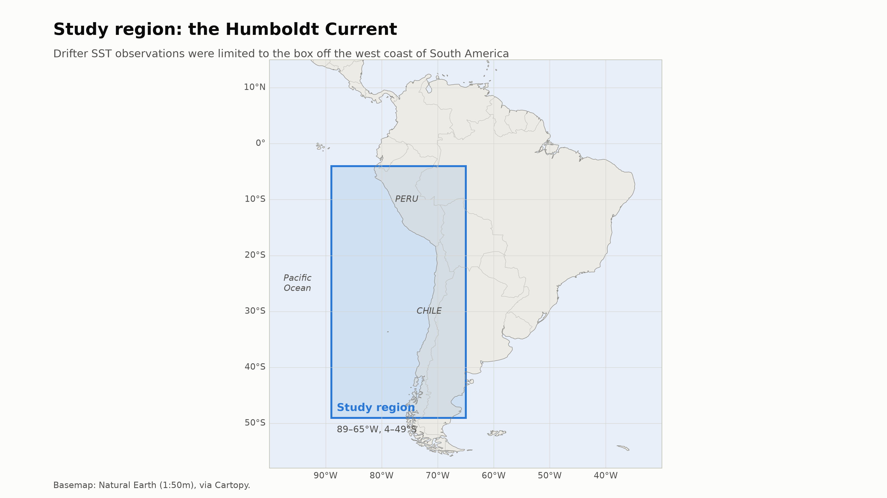
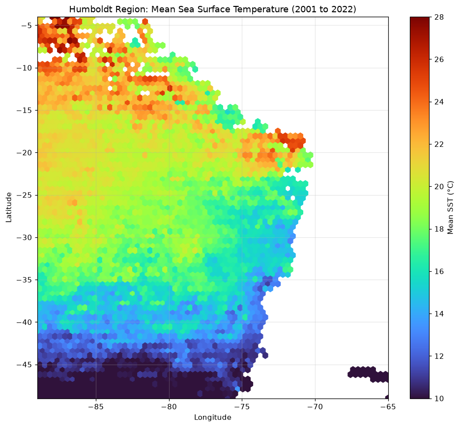
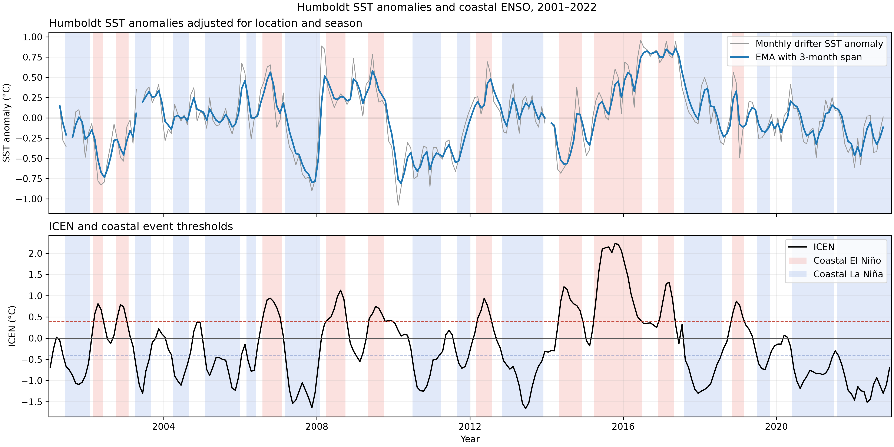

# 🌊 DATA3001 Project: ENSO and the Humboldt Current

**Team Christmas Casuals:** Jayden, Doris, Andre, Prashast and Ashita.



## Table of Contents

- 📚 [Project Description](#-project-description)
- 🌐 [Sources](#-sources)
- 📊 [Insights and Data Analysis](#-insights-and-data-analysis)
- 📓 [Data Description](#-data-description)
- 🏋️ [Workflow](#️-workflow)
- 📈 [Results](#-results)
- 🚦 [Project Status](#-project-status)
- 🏭 [Usage](#-usage)
- 🗂️ [Repository Structure](#️-repository-structure)
- 👥 [Contributors](#-contributors)

---

## 📚 Project Description

### What is the specific objective of this project?

We study how El Niño and La Niña change sea surface temperature (SST) and surface currents in the Humboldt Current off Peru and Chile. We then ask whether knowing that one of these events is under way improves forecasts:

| | Research question |
|---|---|
| **RQ1** | How large are the anomalous shifts in surface velocity (u′, v′) and SST across the Humboldt Current during El Niño and La Niña? |
| **RQ2** | Once an El Niño or La Niña is confirmed, can we predict how long it will last? |
| **RQ3** | Can we predict its effect on SST: the most extreme SST anomaly still to come? |

### Why is it important or significant?

El Niño and La Niña are the two opposite phases of the El Niño–Southern Oscillation (ENSO). Normally, trade winds push warm surface water west across the Pacific, so cold, nutrient-rich water rises along the South American coast (**upwelling**).

- **During El Niño,** the trade winds weaken, upwelling slows and the eastern Pacific warms.
- **During La Niña,** the trade winds strengthen, upwelling increases and the water cools.

The Humboldt Current's upwelling makes it one of the most productive fisheries in the world (FAO Area 87, the Southeast Pacific). El Niño can cut upwelling and disrupt fish populations and catches. Knowing early how long an event will last and how warm or cold the water will get gives fisheries time to plan.

### How does this relate to previous work on this problem?

ENSO is usually tracked with basin-wide indices such as the Oceanic Niño Index (ONI), which measures Niño 3.4 in the central Pacific. We instead use **Peru's coastal index, ICEN** (based on Niño 1+2, right next to our region), and measure the ocean directly with **Lagrangian drifters** rather than gridded satellite products. Rather than forecasting ENSO itself, we forecast what happens **after** a coastal event is confirmed: its remaining length and its peak SST.

## 🌐 Sources

| Source | What it is | Used for |
|---|---|---|
| **Clouddrift `gdp1h`** | Hourly position, velocity and SST from NOAA's Global Drifter Program (drogued and undrogued drifters) | SST and velocity anomalies; the SST forecast target |
| **ICEN** | Peru's coastal El Niño index: centred 3-month mean of the Niño 1+2 SST anomaly, Jan 2001 – Sep 2026 | Defining El Niño / La Niña episodes; duration forecasts; a predictor of SST |
| **Niño 1+2** (`sstoi.indices`) | NOAA CPC monthly SST in the Niño 1+2 region | Comparing indices |
| **ONI** (`oni.ascii.txt`) | NOAA Oceanic Niño Index (Niño 3.4) | First attempt at labelling events, later replaced by ICEN |
| **Sea Around Us** (`fish_data.xlsx`) | Annual catch by species, Humboldt Current LME 13, 1950–2019 | Fish catch versus ENSO and drifter SST |

**Key properties**
- **Size:** the global `gdp1h` arrays are about 8 GB on disk (about 197 million readings). The regional extracts are 110–140 MB.
- **Coverage:** Humboldt Current, 2001–2022. About 2.6 million readings from 695 drifters in the core box, with about 99% of readings between 2001 and 2022.
- **Licence:** all sources are public research data from NOAA, Clouddrift and Sea Around Us.

## 📊 Insights and Data Analysis

**Why anomalies, not raw SST.** Average temperature varies a lot across the region, and the seasonal cycle alone moves it by about 6 °C. The raw monthly regional mean had a 0.92 correlation with the drifters' mean latitude, so it mostly tracked where the drifters happened to be. After comparing each reading with the normal SST for its place and time of year, the anomaly tracks coastal El Niño instead (r = 0.50 with Niño 1+2 in the north of the region).



**SST response (RQ1).**
- During El Niño, SST rises by about 1–2 °C; during La Niña it falls by about 1–2 °C. The strongest effect is between 15°S and 30°S.
- Averaged over the whole region and all episode months, the drifter anomaly is about **+0.16 °C in El Niño and −0.17 °C in La Niña** relative to neutral months, so the drifters detect coastal ENSO in both directions.

**Current response (RQ1).**
- On average (2001–2022) the northern part of the region flows west and the southern part flows east.
- Compared with a neutral control year (April 2013 – March 2014), both El Niño and La Niña clearly change the magnitude and direction of drifter velocities, in different ways. The response is real but weaker and noisier than the SST response.

**Why ICEN rather than ONI.** Our first attempt labelled events with ONI, which measures Niño 3.4 in the middle of the Pacific. Our drifters are off Peru and Chile, and Niño 1+2 (the basis of ICEN) is much closer, so it is a better indicator of El Niño and La Niña here.

**Fish catch.** Strong coastal El Niños caused large anchoveta crashes (1983, 1998), and El Niño years usually bring lower catch over 1982–2019. Within the drifter years (2001–2019), the link is too weak to improve anchoveta catch forecasts beyond persistence.



## 📓 Data Description

**Episode rule.** A coastal **El Niño** is ICEN ≥ +0.4 °C for at least 3 consecutive months, and a coastal **La Niña** is ICEN ≤ −0.4 °C for at least 3 consecutive months. This gives **23 episodes in 2001–2022: 10 El Niño and 13 La Niña.**

### 🔢 Size & Shape

| Data product | Rows | Row meaning |
|---|---|---|
| `data/cache/forecast_obs.npz` | about 4.1 million | One hourly drifter reading in the forecasting box (94°W–65°W, 54°S–4°S) |
| `data/cache/humboldt_obs.npz` | about 2.6 million | One hourly drifter reading in the exploratory box (89°W–65°W, 49°S–4°S), with velocity |
| `data/processed/sst_forecast_data*.csv` | 264 each | One calendar month, 2001–2022 |
| `data/processed/icen_monthly_pm04.csv` | 309 | One calendar month, Jan 2001 – Sep 2026 |

### 📉 Quality Notes

- **Sampling bias:** drifters are not spread evenly, and the south is much colder than the north, so raw averages are biased. Use the anomaly columns.
- **Coverage gaps:** months with fewer than 10 grid cells or 5 drifters are flagged `low_coverage` and are left out of training and scoring.
- **Drogue loss:** about half of the velocity readings come from drifters that have lost their drogue and are pushed by the wind. Velocity analysis uses drogued readings only.
- **Faulty SST:** readings outside 5–35 °C (−2 to 35 °C at the cleaning stage) are dropped.

### Table 1: monthly SST anomaly files (`sst_forecast_data*.csv`)

| Column | Description |
|---|---|
| `year`, `month` | Calendar month |
| `sst_anom` | Area-weighted regional SST anomaly (°C) against a baseline fitted only on earlier years |
| `n_cells` | Number of 2° grid cells with at least 24 readings that month |
| `n_drifters` | Number of distinct drifters that month |
| `low_coverage` | True if `n_cells` < 10 or `n_drifters` < 5 |

### Table 2: ICEN episode file (`icen_monthly_pm04.csv`)

| Column | Description |
|---|---|
| `Date`, `Year`, `Month`, `Month_Name`, `season` | Calendar month and its centred 3-month season (e.g. DJF) |
| `ICEN` | Coastal El Niño index (°C) |
| `ENSO` | El Niño, La Niña or Neutral, using the ±0.4 °C, 3-month rule |
| `Episode` | El Niño, La Niña or No |
| `Episode_ID` | Episode number in time order (blank outside episodes) |

## 🏋️ Workflow

To replicate the results, run `uv run python run_all.py` (see [Usage](#-usage)), or run the notebooks in `notebooks/` in the order listed below, starting with `0_setup.ipynb`. Run every cell top to bottom within each notebook. Each notebook opens with what it does, its inputs and its outputs, and explains each step in its markdown cells.

**Environment:** Python ≥ 3.11 with the packages in `pyproject.toml` (see [Usage](#-usage)).

### 0️⃣ `0_setup.ipynb`: Install everything

**What it does**
- Installs every package at the exact versions in `requirements.txt` (exported from `uv.lock`).
- Never installs into a base Python or base Anaconda: if it isn't already running in a virtual or conda environment, it creates `.venv/` in the repository and registers it as the Jupyter kernel **Christmas Casuals (.venv)**.
- On macOS, installs `libomp` for xgboost with Homebrew if needed, then checks every package imports.

**Outputs**
- A ready project environment. If the notebook says so, switch notebooks 1 to 6 to the **Christmas Casuals (.venv)** kernel.

### 1️⃣ `1_enso_episodes.ipynb`: El Niño / La Niña episodes

**What it does**
- Reads Peru's coastal El Niño index (ICEN), monthly from January 2001.
- Labels each month El Niño, La Niña or Neutral with the ±0.4 °C, 3-month rule, and numbers each episode.
- Prints the episode table: 28 episodes in 2001–2026, 23 of them in the 2001–2022 study period.

**Outputs**
- `data/processed/icen_monthly_pm04.csv`

### 2️⃣ `2_data_cleaning.ipynb`: Drifter Data Cleaning

**What it does**
- Opens the global `gdp1h` arrays without loading them into memory, and reads them in chunks of 2 million readings.
- Keeps readings in the study box (94°W–65°W, 54°S–4°S) and period (2001–2022).
- Converts SST from Kelvin to °C and drops faulty values (outside −2 to 35 °C).
- Recovers each reading's drifter ID.

**Outputs**
- `data/cache/forecast_obs.npz`: the regional extract, about 4.1 million readings. The first run takes a few minutes; later runs load the extract in seconds.

### 3️⃣ `3_sst_anomalies.ipynb`: SST Anomalies (Feature Engineering)

**What it does**
- Fits the normal SST for each place and time of year (B-splines in latitude and longitude, with annual and six-month cycles), using **only years before each forecast period**, so no future information leaks in.
- Subtracts it from every reading, averages the anomalies in 2° cells and combines the cells with area weighting.
- Flags low-coverage months.

**Outputs**
- `data/processed/sst_forecast_data_2011_2013.csv` (baseline 2001–2010)
- `data/processed/sst_forecast_data_2014_2017.csv` (baseline 2001–2013)
- `data/processed/sst_forecast_data.csv` (baseline 2001–2017)

### 4️⃣ `4_exploratory_analysis.ipynb`: Exploratory Analysis (RQ1)

**What it does**
- Builds its own extract with velocity (89°W–65°W, 49°S–4°S) and computes location-corrected SST anomalies.
- Compares the SST anomaly with ONI and Niño 1+2.
- Measures the current response to El Niño and La Niña, using drogued drifters only.
- Compares fish catch with coastal events and drifter SST, and tests anchoveta catch forecasts.

It is independent of notebooks 1–3, so it can be run at any point.

**Outputs**
- The figures in `figures/` (SST vs ONI and Niño 1+2, forecast skill, fish catch, anchoveta models).

### 5️⃣ `5_forecast_next_month_sst.ipynb`: Next-Month SST Forecast

**What it does**
- Trains on 2001–2017 and tests on 2018–2022 (58 months).
- Compares persistence, linear regression on lagged SST and season, regression plus lagged ICEN, and XGBoost.
- Reports MAE and RMSE overall and by ENSO phase.

**Outputs**
- Error tables (printed).

### 6️⃣ `6_forecast_duration_and_peak.ipynb`: Duration and Peak SST Forecasts (RQ2 and RQ3)

**What it does**
- **Duration:** once an episode is confirmed (its 3rd month, plus 2 months for ICEN to be published), forecasts how many months it has left. ARIMA(1,0,1) is fitted to the ICEN history and forecast forward; the first month it crosses back inside ±0.4 °C is the predicted end. ETS and BSTS are tested too.
- **Peak SST:** ARIMA's predicted end sets the horizon. A Generalised Additive Model (recent SST anomalies, season and a curved effect of ICEN) forecasts the monthly SST anomaly, and the highest (El Niño) or lowest (La Niña) point is the forecast peak.
- **Baselines:** historical median and linear regression for duration; persistence and historical median for the peak.
- **Evaluation:** MAE and RMSE on exactly the same episodes for every method (15 for duration, 5 for the peak), using only information available on the forecast date.

Duration and peak share one notebook because the peak forecast reuses the duration code and its ARIMA forecasts.

**Outputs**
- Episode-by-episode forecast tables and MAE / RMSE summaries (printed).

### ✅ Summary

Raw drifter readings → regional extract → location-corrected SST anomalies → El Niño / La Niña episodes from ICEN → next-month, duration and peak-SST forecasts compared against simple baselines.

## 📈 Results

With only 23 events, we chose **statistical models over machine learning**: they overfit less on a small sample, are interpretable and need little data.

**Duration: months left in an episode (15 shared episodes, MAE in months)**

| Phase | Episodes | Historical median | Linear regression | ARIMA |
|---|---|---|---|---|
| El Niño | 7 | 2.00 | **1.87** | 3.43 |
| La Niña | 8 | 4.88 | **4.09** | 4.25 |
| All | 15 | 3.53 | **3.05** | 3.87 |

**Peak SST: most extreme anomaly still to come (5 scored episodes, MAE in °C)**

| Phase | Episodes | Persistence | Historical median | ARIMA + GAM |
|---|---|---|---|---|
| El Niño | 2 | 0.717 | 0.583 | **0.564** |
| La Niña | 3 | 0.225 | **0.099** | 0.229 |

**Next-month SST (58 test months, MAE in °C):** persistence 0.216, regression 0.195, XGBoost 0.195.

**What this means**
- **Duration:** how strong an episode is when it's confirmed (the regression) is the most useful single predictor. ARIMA tends to forecast episodes as too long, but it is the only method that gets the longest episodes right.
- **Peak:** ARIMA + GAM beats persistence for El Niño, but it underestimates strong events. For 2015–16 it forecast +0.20 °C against an actual +1.00 °C. For La Niña, the typical past extreme works best.
- **Next-month SST:** lagged SST holds most of the signal; ICEN and XGBoost add almost nothing.

> **Improved versions and the presentation's figures.** Ashita's scripts in `src/` add simulated versions of both models. Simulating 1,000 noisy ICEN paths (**ARIMA sim**) cuts the duration error to **2.60 months** overall. Simulating whole SST paths (**GAM sim**) cuts the peak error to **0.355 °C** (El Niño) and **0.024 °C** (La Niña). The presentation's figures (2.57 / 1.83 months; 0.786 → 0.608 and 0.319 → 0.165 °C) come from an earlier episode rule (> +0.5 / < −0.7 °C). See [`docs/forecasting_results.md`](docs/forecasting_results.md) for all of these.

## 🚦 Project Status

**Progress so far**
- Drifter data downloaded, filtered to the Humboldt Current and cached as regional extracts.
- Location-corrected SST anomalies built, with past-only baselines for forecasting.
- El Niño / La Niña episodes defined from ICEN with the ±0.4 °C, 3-month rule.
- SST and current responses to ENSO measured, and fish catch compared (RQ1).
- Duration and peak-SST forecasts built and compared with baselines on the same episodes (RQ2, RQ3).
- Notebook pipeline wired end to end: `1_enso_episodes` → `2_data_cleaning` → `3_sst_anomalies` → `4_exploratory_analysis` → `5_forecast_next_month_sst` → `6_forecast_duration_and_peak`.

**Limitations**
- **Very few events.** 23 episodes, with only 15 usable for duration and 5 for peak SST (2 of them El Niño). Some overfitting is unavoidable with events this rare, and no ranking is statistically secure.
- **Real-time data.** The model needs current drifter observations, so delays in the data directly hurt accuracy. Fisheries need SST information weeks to a month ahead.
- **Threshold choice matters.** Results change noticeably between the ±0.4 °C and the > +0.5 / < −0.7 °C rule.
- **Reconstructed inputs.** Two of the three SST forecast files were rebuilt by re-running the preprocessing with later baseline years.
- **Catch is not fish.** Quotas and season closures affect catch as well as the ocean.

**Next steps**
- Improve El Niño accuracy. One of the strongest El Niño events on record is under way and expected to intensify through late 2026, which gives the model a real-time use case.
- Bring the simulated models (ARIMA sim, GAM sim) into notebook 6, and use the ARIMA sim duration as the peak horizon.
- Forecast the northern SST (north of 30°S), where the coastal El Niño signal is strongest.
- Train duration models on a longer ICEN / Niño 1+2 record (back to the 1950s).
- Report forecast ranges (10th–90th percentiles of the simulations), not just one number.

## 🏭 Usage

### ⚡ Quick start (run everything)

```bash
git clone https://github.com/Ashi0117/Christmas-Casuals.git
cd Christmas-Casuals
uv sync                          # installs Python 3.11 and every package in pyproject.toml
uv run python run_all.py         # runs notebooks 0 to 6 in order
```

**Without `uv`:** open `notebooks/0_setup.ipynb` in Jupyter or VS Code with any Python 3.11+ and run it. It creates the project environment and installs everything (see [0️⃣](#0️⃣-0_setupipynb-install-everything)). Then run notebooks 1 to 6 in order on the **Christmas Casuals (.venv)** kernel. Plain `pip install -r requirements.txt` inside your own virtual environment also works.

`run_all.py` executes each notebook top to bottom and saves its outputs, figures and CSVs. To run only some notebooks, pass their numbers, e.g. `uv run python run_all.py 3 5`. You can also open the notebooks in Jupyter or VS Code (kernel: the project's `.venv`) and run them in order.

The first run needs an internet connection: notebook 2 downloads the Clouddrift drifter arrays (about 8 GB of disk) and builds the regional extracts, which takes a while. Later runs reuse `data/cache/`; once the arrays are downloaded, the six notebooks take about 3 minutes in total. The arrays are read in chunks (peak memory about 1.2 GB), so the whole pipeline runs on an 8 GB laptop.

### 📦 Environment

The project uses Python ≥ 3.11 and [`uv`](https://docs.astral.sh/uv/). The key packages are numpy, pandas, scipy, scikit-learn, statsmodels, xgboost, matplotlib, openpyxl and clouddrift; cartopy is only used for the study-region map, and nbconvert/ipykernel run the notebooks.

On macOS, xgboost also needs `brew install libomp`.

### Drifter data

The drifter data is too large for the repository (about 8 GB), so `data/cache/` is not uploaded. It is created on the first run: `2_data_cleaning.ipynb` and `4_exploratory_analysis.ipynb` (and `src/data_cleaning.py`) download any missing Clouddrift `gdp1h` arrays into `data/cache/` as `.npy` files, then save the smaller regional extracts (`forecast_obs.npz`, `humboldt_obs.npz`). Later runs reuse the cached files. The download needs `clouddrift` and an internet connection.

### Standalone scripts

Ashita's original scripts are in `src/`. They include the extra hazard, ARIMA sim, GAM sim and blend models, and run from any folder:

```bash
python src/relabel_icen.py                  # ICEN episodes
python src/forecast_monthly_sst.py          # next-month SST
python src/forecast_episode_duration.py     # duration (RQ2), about 5 seconds
python src/forecast_peak_sst_arima_gam.py   # peak SST (RQ3)
```

The three forecasting scripts only need the CSVs in `data/processed/`.

## 🗂️ Repository Structure

```
Christmas-Casuals/
├── README.md
├── run_all.py                 ← runs notebooks 0 to 6 in order
├── pyproject.toml / uv.lock / .python-version
├── requirements.txt           pinned versions (exported from uv.lock) for pip users
├── notebooks/                 ← run in order, 0 to 6
│   ├── 0_setup.ipynb
│   ├── 1_enso_episodes.ipynb
│   ├── 2_data_cleaning.ipynb
│   ├── 3_sst_anomalies.ipynb
│   ├── 4_exploratory_analysis.ipynb
│   ├── 5_forecast_next_month_sst.ipynb
│   ├── 6_forecast_duration_and_peak.ipynb
│   └── archive/               the earlier combined notebooks
├── src/                       ← Ashita's standalone scripts
├── data/
│   ├── cache/                 created on first run (downloaded drifter arrays and extracts; not in git)
│   ├── raw/                   ICEN, ONI, Niño 1+2, fish catch
│   └── processed/             relabelled ICEN, monthly SST anomaly files
├── figures/                   all figures (archive_oni/ holds early ONI-based figures)
└── docs/
    ├── 01_exploratory_analysis_explained.md
    ├── 02_forecasting_pipeline_explained.md
    ├── forecasting_results.md
    └── presentation_speech.docx
```

The two `docs/*_explained.md` walkthroughs describe the earlier combined notebooks: `01` matches notebook 4, and `02` covers notebooks 1–3, 5 and 6.

## 👥 Contributors

This project was developed as part of DATA3001.

- **Jayden:** project introduction, limitations and future work.
- **Doris:** El Niño / La Niña background and region analysis.
- **Andre:** data preparation, feature engineering, exploratory notebook and modelling methodology.
- **Prashast:** initial SST and velocity analysis, and the choice of Niño 1+2 over ONI.
- **Ashita:** forecasting scripts (episode duration and peak SST) and findings.
